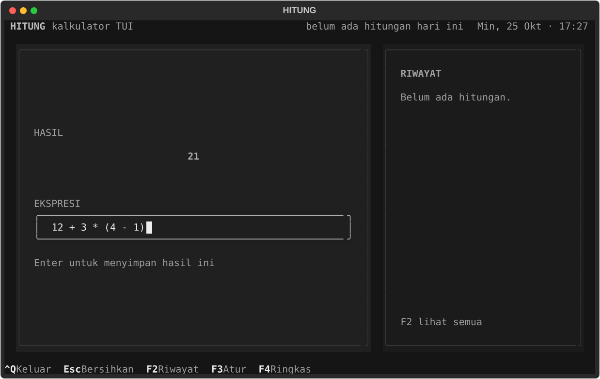
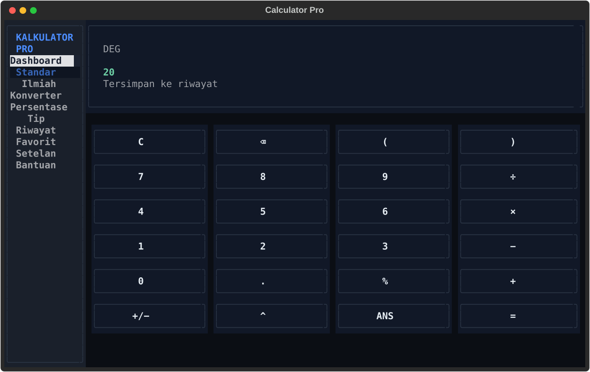
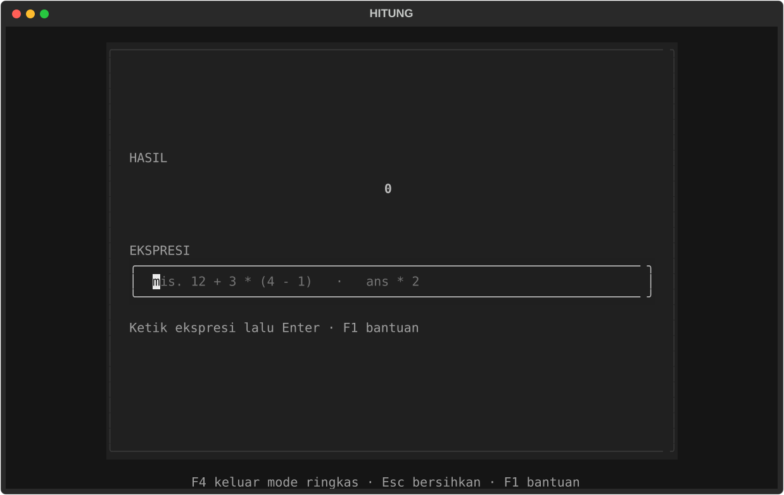

# HITUNG — Kalkulator TUI untuk Terminal

Kalkulator berbasis terminal (TUI), 100% Python, dibangun dengan
[Textual](https://textual.textualize.io/). Ketik ekspresi, hasilnya muncul
langsung saat mengetik, lalu `Enter` menyimpannya ke riwayat. Satu kartu,
satu panel riwayat, tanpa mouse, tanpa jaringan.

**Paling cepat:** jalankan `.\run.cmd` dari folder project — satu baris,
tanpa perlu aktivasi venv.


## Install & jalankan (dari GitHub)

**Opsi 1 — paling gampang (Windows):** clone repo lalu jalankan:

```powershell
git clone https://github.com/ujangboy/belajar-python.git
cd "belajar-python/03_Mini_Projects/kalkulator TUI"
.\run.cmd
```

Bisa juga download ZIP lewat tombol **Code → Download ZIP**, ekstrak, lalu
jalankan `run.cmd` di folder `03_Mini_Projects/kalkulator TUI`.

**Opsi 2 — lewat pip (semua OS, tanpa download manual):**

```powershell
pip install "git+https://github.com/ujangboy/belajar-python.git#subdirectory=03_Mini_Projects/kalkulator%20TUI"
hitung
```

Nama folder `kalkulator TUI` mengandung spasi, jadi di URL ditulis
`kalkulator%20TUI`. Setelah terpasang lewat pip, aplikasi bisa dibuka dari
folder mana pun dengan perintah `hitung` atau `kalkulator`.

## Fitur

- Mesin hitung sendiri (tanpa `eval`): `+ - * / ^ % !` dan tanda kurung.
- Fungsi `sqrt`, `abs`, `sin`, `cos`, `tan`, `asin`, `acos`, `atan`, `log`,
  `ln`, `exp`, `floor`, `ceil`, `round`.
- Konstanta `pi`, `e`, `tau`, dan variabel `ans` (hasil terakhir).
- **Preview langsung:** hasil sementara muncul saat mengetik; `Enter`
  menyimpannya sebagai hasil final.
- Riwayat hitungan tersimpan lokal: panel 5 terakhir di samping kartu, dan
  layar riwayat lengkap dengan ringkasan + grafik 7 hari.
- `↑` / `↓` memanggil ulang ekspresi sebelumnya, seperti riwayat shell.
- Salin hasil ke clipboard dengan `Ctrl+Y`.
- Format angka Indonesia: titik ribuan, koma desimal (`1.234.567,5`).
- Presisi 0–10 desimal, notasi ilmiah otomatis untuk angka ekstrem.
- Mode sudut derajat/radian dan bunyi bel (bisa dimatikan).
- Mode ringkas (`F4`) untuk layar sempit atau sekadar fokus.
- Terminal minimum 60 × 18; ada pesan ramah kalau terlalu kecil.
- Tanpa jaringan, tanpa akun. Semua data lokal.

## Jalankan dengan satu baris

Di PowerShell atau cmd, dari folder project ini:

```powershell
.\run.cmd
```

Itu saja. `run.cmd` mencari Python yang cocok secara otomatis (venv repo,
venv project, atau Python di PATH), memasang dependency kalau belum ada,
lalu langsung membuka aplikasi. Tidak perlu aktivasi venv dan tidak perlu
`pip install` manual.

> Satu-satunya prasyarat di Windows: Python 3.11+ sudah terpasang. Kalau
> `run.cmd` bilang Python belum ditemukan, install dari
> <https://www.python.org/downloads/> dengan opsi **Add python.exe to PATH**
> dicentang, buka terminal baru, lalu jalankan lagi.

## Perintah global: `hitung` / `kalkulator`

Setelah install lewat pip (lihat **Install & jalankan → Opsi 2**), aplikasi
bisa dibuka dari folder mana pun:

```powershell
hitung
```

atau `kalkulator`. Tidak perlu `cd` dan tidak perlu aktivasi venv.

Di Windows ada juga cara tanpa pip: buat file `hitung.cmd` kecil di folder
yang ada di PATH (mis.
`C:\Users\<kamu>\AppData\Local\Programs\Python\Python313\Scripts\`), isinya:

```bat
@echo off
call "D:\path\ke\kalkulator TUI\run.cmd" %*
```

## Prasyarat

- Python 3.11 atau lebih baru (dites di 3.13).
- Windows Terminal / PowerShell, atau terminal modern lain
  (Linux dan macOS juga jalan).
- Font monospace yang mendukung karakter kotak `─ │ ╭ ╮` dan `█ · ↑ ↓`
  (mis. Cascadia Mono, JetBrains Mono, Fira Code).
- Clipboard (`Ctrl+Y`) memakai OSC 52; Windows Terminal dan kebanyakan
  terminal modern mendukungnya. Kalau tidak, hasil tetap tampil di layar.

## Instalasi dependency

Kalau memakai `.\run.cmd`, langkah ini tidak perlu — dependency dipasang
otomatis pada run pertama. Untuk setup manual, dari folder project ini:

```powershell
# Aktifkan venv milik repo (kalau belum ada: python -m venv ..\..\.venv)
..\..\.venv\Scripts\Activate.ps1

# Install dependency runtime
pip install -r requirements.txt
```

Untuk kebutuhan development (test dan tool screenshot):

```powershell
pip install -r requirements-dev.txt
```

Opsional: pasang project ini sebagai package supaya ada perintah global
`hitung` / `kalkulator`:

```powershell
pip install -e .

# lalu dari folder mana pun:
hitung
```

## Cara lain menjalankan

Selain `.\run.cmd`, aplikasi juga bisa dijalankan dengan cara berikut
(semua dari folder project):

| Cara | Perintah |
| --- | --- |
| Venv bersama repo | `..\..\.venv\Scripts\python.exe main.py` |
| Venv sudah aktif | `python main.py` |
| Sebagai modul Python | `python -m hitung` |
| Setelah `pip install -e .` | `hitung` atau `kalkulator` (dari folder mana pun) |

Kalau muncul `ModuleNotFoundError: No module named 'textual'`, berarti yang
dipakai bukan Python yang punya Textual. Paling mudah pakai `.\run.cmd`.

## Kontrol

| Tombol | Aksi |
| --- | --- |
| *ketik* | langsung menulis ekspresi di input |
| `Enter` | hitung dan simpan ke riwayat |
| `Esc` | bersihkan ekspresi |
| `↑` / `↓` | panggil ekspresi sebelumnya / berikutnya |
| `Ctrl+Y` | salin hasil ke clipboard |
| `F1` | bantuan |
| `F2` | riwayat lengkap |
| `F3` | pengaturan |
| `F4` | mode ringkas |
| `Ctrl+Q` | keluar |

Aksi memakai `Ctrl`/`F1`–`F4` (bukan huruf biasa) karena huruf dipakai untuk
mengetik nama fungsi dan konstanta seperti `sin`, `log`, atau `pi`.

## Format ekspresi

**Operator** (prioritas dari rendah ke tinggi):

| Operator | Arti | Contoh |
| --- | --- | --- |
| `+` `-` | tambah / kurang | `12 + 3` |
| `*` `/` | kali / bagi | `12 / 4` |
| `-` (awalan) | negatif | `-5 + 2` |
| `^` | pangkat (kanan-asosiatif) | `2^3^2 = 512` |
| `%` (akhiran) | bagi 100 | `200 * 15% = 30` |
| `!` (akhiran) | faktorial, 0–170 | `5! = 120` |
| `( )` | kurung | `(2 + 3) * 4` |

Catatan:

- `-2^2` dihitung `-(2^2) = -4`; `2^-3 = 0,125`.
- Desimal boleh pakai koma atau titik: `1,5` dan `1.5` sama-sama diterima.
- `%` adalah akhiran "bagi 100", bukan persen-dari-kontekstual.
  Jadi `200 * 15% = 30`, sedangkan `200 + 15% = 200,15`.

**Fungsi satu argumen:**

| Fungsi | Keterangan |
| --- | --- |
| `sqrt(x)` | akar kuadrat (x ≥ 0) |
| `abs(x)` | nilai absolut |
| `sin(x)` `cos(x)` `tan(x)` | trigonometri, mengikuti mode sudut |
| `asin(x)` `acos(x)` `atan(x)` | invers trigonometri |
| `log(x)` `ln(x)` | logaritma basis 10 / natural (x > 0) |
| `exp(x)` | e pangkat x |
| `floor(x)` `ceil(x)` | pembulatan ke bawah / atas |
| `round(x)` | pembulatan setengah ke atas (`2,5 → 3`) |

**Konstanta & variabel:** `pi`, `e`, `tau`, dan `ans` (hasil perhitungan
terakhir). Contoh: `ans * 2` menggandakan hasil sebelumnya.

**Contoh ekspresi:**

```text
12 + 3 * (4 - 1)        → 21
sqrt(144) + 2^3         → 20
200 * 15%               → 30
sin(30)                 → 0,5      (mode derajat)
1,5 + 2                 → 3,5
5!                      → 120
ans * 2                 → hasil sebelumnya dikali 2
```

Kalau ekspresi salah, pesan error ditulis dalam Bahasa Indonesia, misalnya
`Pembagian dengan nol tidak terdefinisi` atau `Kurung tutup ')' kurang`.

## Alur pemakaian

```text
ketik ekspresi
     │  (preview biru muncul saat valid)
     ▼
Enter ──▶ simpan ke riwayat ──▶ hasil final (mint) + panel riwayat
     │
     ├── Esc  bersihkan input
     ├── ↑ ↓  panggil ulang ekspresi lama
     └── ans  pakai hasil terakhir di ekspresi berikutnya
```





## Pengaturan

| Pengaturan | Rentang | Default |
| --- | --- | --- |
| Presisi (digit desimal) | 0–10 | 6 |
| Pemisah ribuan | on/off | on |
| Mode sudut | derajat / radian | derajat |
| Suara (bell) | on/off | on |

Pengaturan dibuka dengan `F3` dan disimpan ke `config.json`.


## Lokasi Data

Secara default:

- Windows: `%APPDATA%\Hitung\`
- macOS: `~/Library/Application Support/Hitung/`
- Linux: `~/.local/share/hitung/` (atau `$XDG_DATA_HOME/hitung`)

Isi folder:

- `config.json` — pengaturan aplikasi.
- `history.jsonl` — riwayat hitungan, satu JSON per baris.

Lokasi data bisa diganti lewat environment variable, misalnya untuk testing:

```powershell
$env:HITUNG_DATA_DIR = "D:\data\hitung"; .\run.cmd
```

## Struktur Project

```text
kalkulator TUI/
├─ run.cmd                   # satu perintah untuk menjalankan (Windows)
├─ main.py                   # entry point `python main.py`
├─ pyproject.toml            # metadata package + perintah `hitung`/`kalkulator`
├─ hitung/
│  ├─ app.py                # App Textual, keybinding, preview & simpan
│  ├─ engine.py             # tokenizer + parser + evaluasi (bebas UI)
│  ├─ format.py             # format angka Indonesia & presisi
│  ├─ history.py            # record riwayat + agregasi 7 hari + recall
│  ├─ config.py             # Settings + lokasi data
│  ├─ storage.py            # baca/tulis config & riwayat
│  ├─ theme.py              # palet warna
│  ├─ text.py               # helper potong teks
│  ├─ hitung.tcss           # styling Textual
│  ├─ screens/              # riwayat, pengaturan, bantuan, konfirmasi
│  └─ widgets/              # topbar, kartu hitung, panel riwayat, grafik
├─ tests/                   # unit + integration test (pytest)
├─ tools/                   # dev: screenshot & dump layout SVG
└─ docs/                    # screenshot SVG
```


## Testing

```powershell
..\..\.venv\Scripts\python.exe -m pytest -q
```

Kalau venv sudah aktif, cukup `python -m pytest -q`. **112 test** mencakup:

- evaluasi ekspresi: prioritas operator, kurung, pangkat kanan-asosiatif,
  unary minus, persen, faktorial, fungsi, konstanta, `ans`, desimal koma;
- pesan error: ekspresi kosong, kurung tidak seimbang, bagi nol, domain
  fungsi, nama tidak dikenal, overflow, faktorial tidak valid;
- format angka: ribuan, koma desimal, pembulatan setengah ke atas,
  notasi ilmiah, presisi yang di-clamp;
- config: default, clamp, toleransi nilai aneh, override lokasi data;
- penyimpanan: round-trip config, config rusak di-backup, riwayat JSONL,
  baris rusak dilewati, hapus riwayat;
- riwayat: hitungan hari ini, 7 hari, record terbaru, recall ekspresi unik;
- alur UI lewat `run_test` 100×30: preview live, simpan, error, Esc, recall
  `↑`/`↓`, salin, `ans`, modal riwayat + hapus, pengaturan, bantuan,
  mode ringkas, terminal sempit, resize, dan data yang bertahan setelah
  aplikasi dibuka ulang.

## Alat Development

`tools/screenshot.py` — bikin ulang screenshot SVG ke `docs/`:

```powershell
python -m tools.screenshot
```

`tools/svg_dump.py` — ubah screenshot SVG jadi grid teks, berguna untuk
verifikasi layout tanpa membuka terminal:

```powershell
python -m tools.svg_dump docs/main.svg
```

## Desain

- Palet gelap tenang: latar `#12151C`, kartu `#1A202B`,
  teks `#E6EDF3`, muted `#93A1B3`.
- Aksen mint `#6FD3A8` untuk hasil final; biru `#8AB4F8` untuk hasil preview;
  coral `#FF7A6B` untuk error.
- Satu border di kartu utama, tanpa emoji, tanpa kedip.
- Hasil besar di tengah kartu; input di bawahnya; status satu baris.
- Panel riwayat hanya muncul kalau lebar terminal ≥ 86 kolom agar kartu
  tetap lega; mode ringkas menyembunyikan seluruh chrome.



## Troubleshooting

- **`run.cmd` bilang "Python belum ditemukan"** — Python belum terpasang
  atau belum masuk PATH. Install Python 3.11+ dari
  <https://www.python.org/downloads/> dengan opsi
  *Add python.exe to PATH* dicentang, buka terminal baru, lalu jalankan
  `.\run.cmd` lagi.
- **`run.cmd` gagal memasang dependency** — biasanya tidak ada koneksi
  internet. Coba lagi, atau pasang manual dengan Python yang sama:
  `<path-python> -m pip install -r requirements.txt`. `run.cmd` sudah
  mencetak perintah lengkapnya kalau gagal.
- **`ModuleNotFoundError: No module named 'textual'`** — yang terpakai
  bukan Python yang punya Textual (biasanya `python` mengarah ke Python
  global, venv belum aktif). Paling mudah pakai `.\run.cmd`. Alternatif:
  `..\..\.venv\Scripts\python.exe main.py`, atau aktifkan venv
  (`..\..\.venv\Scripts\Activate.ps1`) lalu `pip install -r requirements.txt`.
  Cek interpreter yang aktif: `python -c "import sys; print(sys.executable)"`.
- **PowerShell menolak `Activate.ps1`** (execution policy) — tidak perlu
  aktivasi: pakai `.\run.cmd` atau jalur langsung
  `..\..\.venv\Scripts\python.exe main.py`. Kalau tetap ingin aktivasi,
  jalankan sekali: `Set-ExecutionPolicy -Scope CurrentUser RemoteSigned`.
- **`Ctrl+Y` tidak menyalin apa pun** — terminal tidak mendukung OSC 52
  (mis. sesi SSH lama). Hasil tetap tampil di layar dan tersimpan di
  riwayat; salin manual dari sana.
- **Terminal terlalu kecil** — aplikasi menampilkan pesan
  "minimal 60 × 18". Perbesar jendela atau perkecil font terminal.

## Catatan & Batasan

- **Presisi angka** memakai `float` Python, jadi hasil desimal panjang bisa
  menampilkan sisa pembulatan (mis. `0,1 + 0,2 = 0,3` sudah dirapikan oleh
  preset format; presisi bisa diubah di pengaturan).
- **Satu instance saja**: dua instance yang jalan bersamaan akan menulis
  ke file riwayat yang sama.
- **Keluar saat ada input**: input yang belum di-`Enter` tidak disimpan,
  sama seperti kalkulator biasa.
- **Riwayat tidak dibatasi ukuran** di v1; hapus lewat `F2 → Hapus semua`.
- **Tanpa memori M+/MR/MC**: pakai `ans` untuk merangkai hasil.

## Non-Goals (v1)

Tanpa variabel bernama, tanpa grafik fungsi, tanpa konversi satuan, tanpa
mode programmer (hex/bin), tanpa cloud sync, tanpa akun, dan tanpa
notifikasi OS. Notifikasi cukup lewat baris status dan toast Textual.

## Status

Versi 1.0.0 — siap dipakai. 112 test lulus, screenshot di `docs/` dibuat
ulang lewat `tools/screenshot.py`, dan aplikasi sudah dicoba berjalan
sungguhan di terminal (Windows Terminal / PowerShell) lewat `.\run.cmd`.

## Lisensi

Bebas dipakai untuk belajar.
