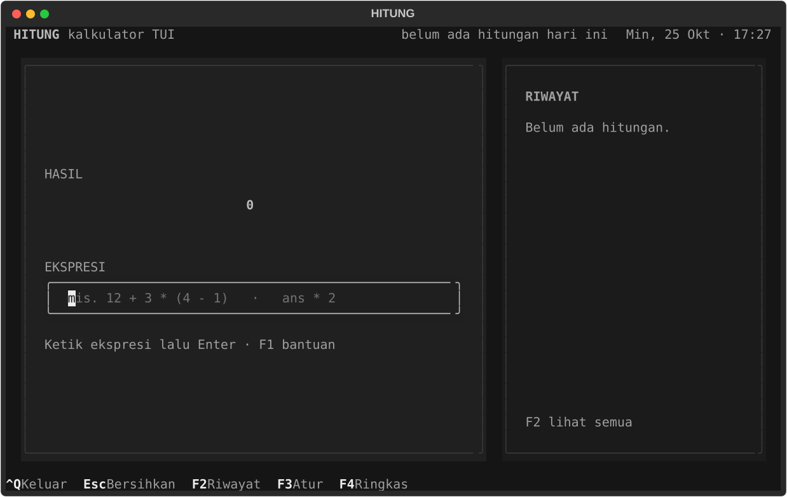
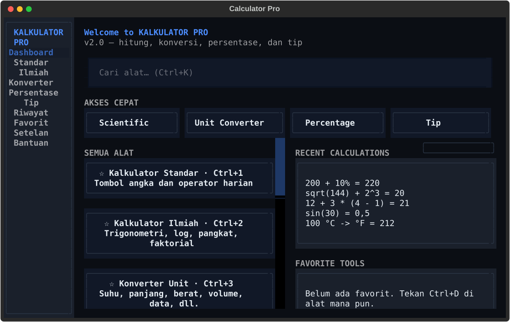
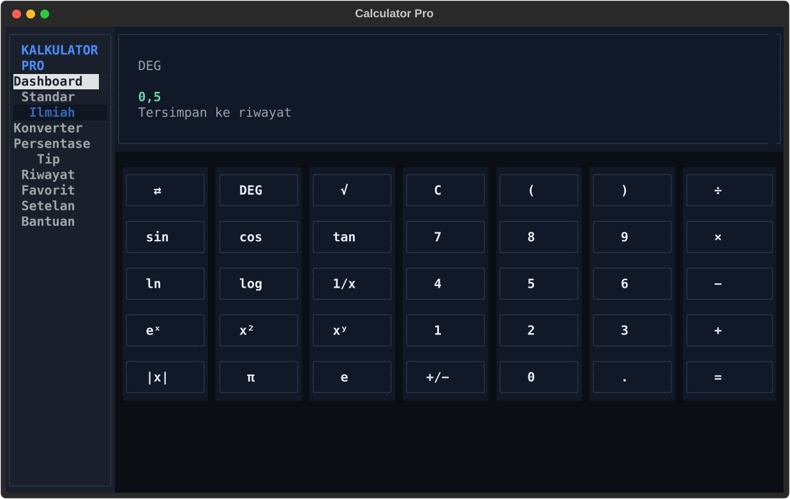
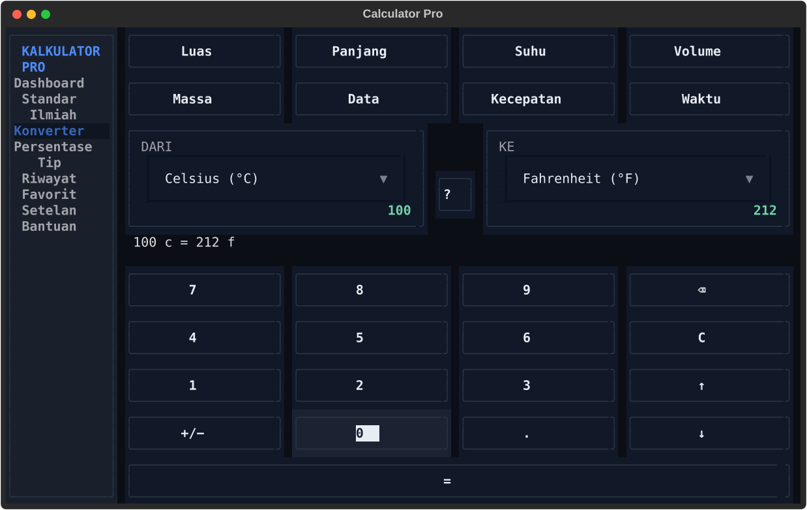
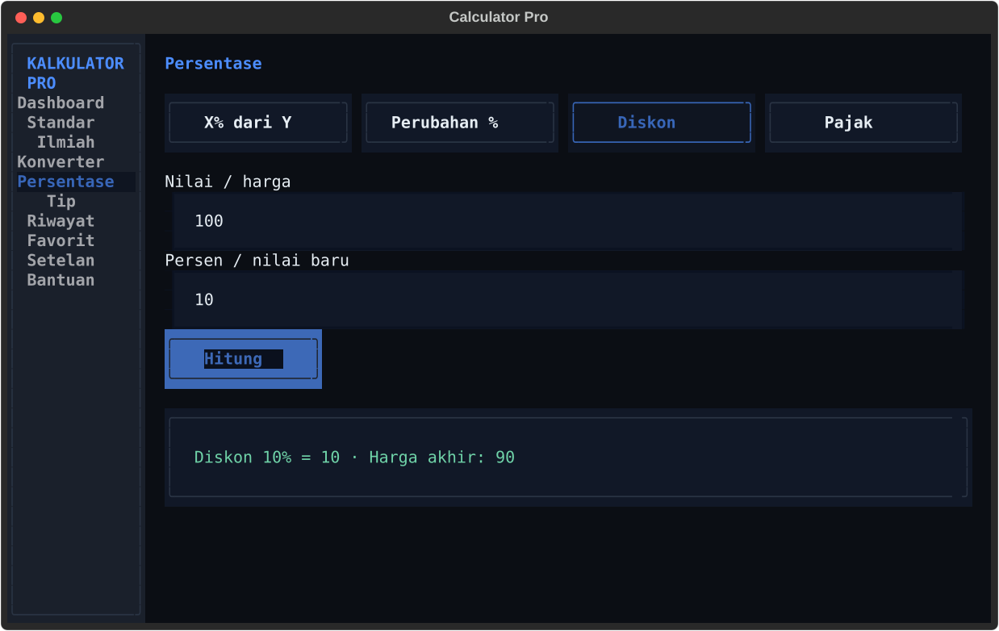
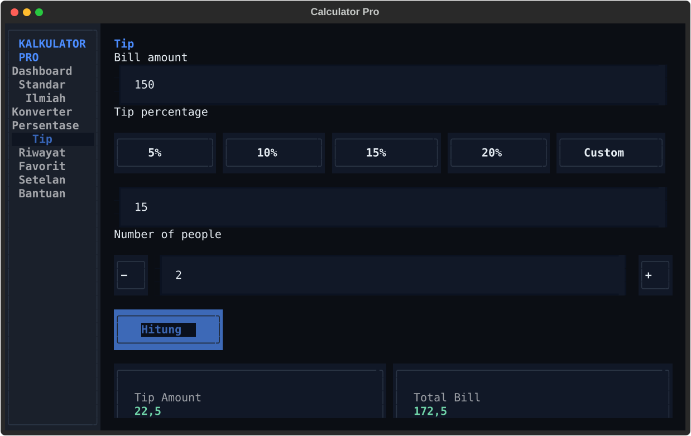
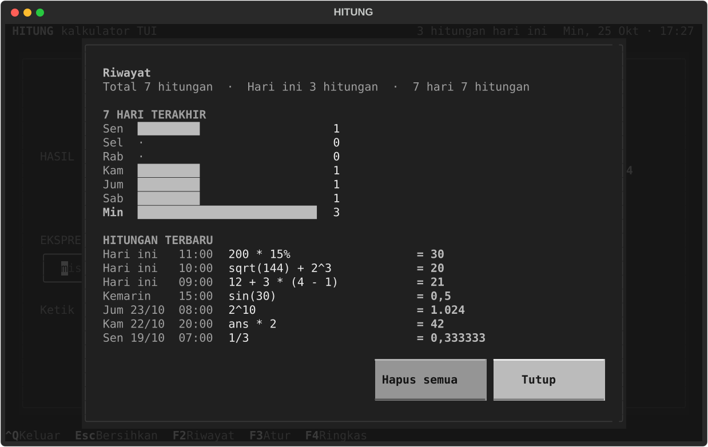
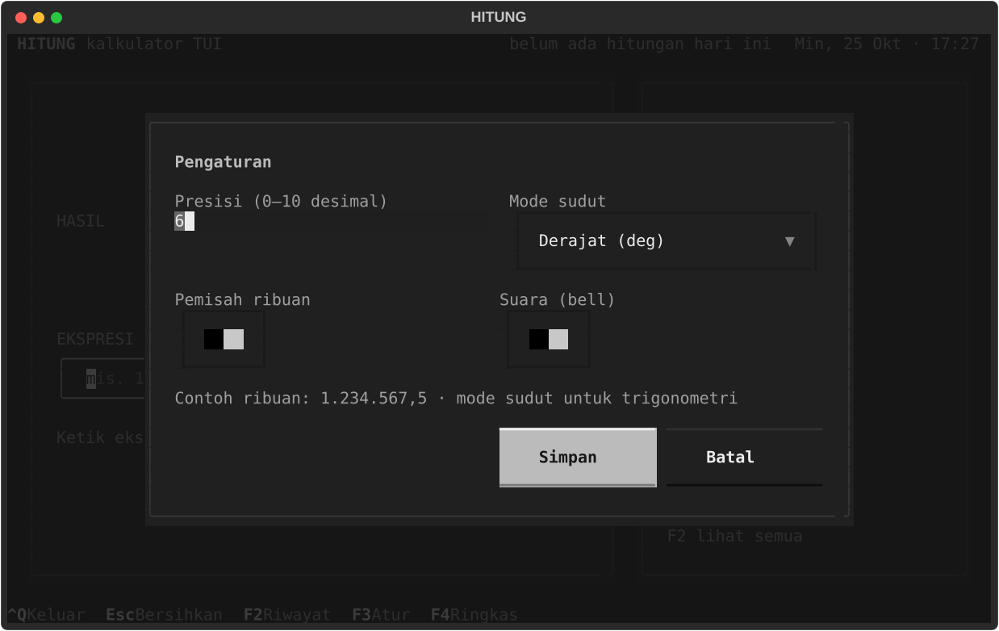
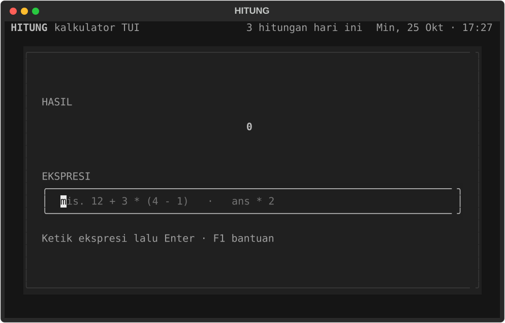

# KALKULATOR PRO — Kalkulator TUI untuk Terminal

Kalkulator berbasis terminal (TUI), 100% Python, dibangun dengan
[Textual](https://textual.textualize.io/). Versi 2.0 memakai **tombol**:
pilih alat di sidebar, klik angka dan operator, hasil tampil besar di
layar. Keyboard tetap bisa dipakai. Tanpa jaringan, tanpa akun.

**Paling cepat:** jalankan `.\run.cmd` dari folder project — satu baris,
tanpa perlu aktivasi venv.



## Install & jalankan (dari GitHub)

**Opsi 1 — paling gampang (Windows):** clone repo lalu jalankan:

```powershell
git clone https://github.com/ujangboy/belajar-python.git
cd "belajar-python/03_Mini_Projects/kalkulator TUI"
.\run.cmd
```

Bisa juga download ZIP lewat tombol **Code → Download ZIP**, ekstrak, lalu
jalankan `run.cmd` di folder `03_Mini_Projects/kalkulator TUI`.

**Opsi 2 — lewat pip (semua OS, tanpa download manual):**

```powershell
pip install "git+https://github.com/ujangboy/belajar-python.git#subdirectory=03_Mini_Projects/kalkulator%20TUI"
hitung
```

Nama folder `kalkulator TUI` mengandung spasi, jadi di URL ditulis
`kalkulator%20TUI`. Setelah terpasang lewat pip, aplikasi bisa dibuka dari
folder mana pun dengan perintah `hitung` atau `kalkulator`.

## Alat yang tersedia

| Alat | Isi |
| --- | --- |
| **Dashboard** | Akses cepat, riwayat 5 terakhir, favorit, pencarian alat |
| **Kalkulator Standar** | Tombol `0–9`, `+ − × ÷`, `%`, `±`, `C`, `⌫`, `=` |
| **Kalkulator Ilmiah** | `sin cos tan`, `ln log`, `√`, `x²`, `xʸ`, `1/x`, `π`, `e`, `!`, `DEG/RAD` |
| **Konverter Unit** | 8 kategori: luas, panjang, suhu, volume, massa, data, kecepatan, waktu |
| **Persentase** | X% dari Y, perubahan %, diskon, pajak |
| **Tip** | Tagihan, persen cepat 5/10/15/20, jumlah orang, hasil per orang |
| **Riwayat** | Ringkasan hari ini/7 hari, grafik batang, hapus semua |
| **Favorit** | Alat yang ditandai dengan `Ctrl+D` |
| **Pengaturan** | Presisi, ribuan, mode sudut, tema, aksen, format angka, suara |
| **Bantuan** | Peta tombol, operator, fungsi, dan contoh |

Setiap alat hidup di dalam satu layar. Sidebar di kiri dipakai untuk pindah
alat; di terminal sempit (< 90 kolom) sidebar disembunyikan dan navigasi
lewat pintasan keyboard atau dashboard.



## Fitur

- Mesin hitung sendiri (tanpa `eval`): `+ - * / ^ % !` dan tanda kurung.
- Fungsi `sqrt`, `cbrt`, `abs`, `sin`, `cos`, `tan`, `asin`, `acos`, `atan`,
  `log`, `ln`, `log10`, `exp`, `floor`, `ceil`, `round`, `ncr`, `npr`.
- Konstanta `pi`, `e`, `tau`, dan variabel `ans` (hasil terakhir).
- Konverter unit dengan hasil langsung saat angka diketik, tombol swap,
  dan riwayat per kategori.
- Persentase dan tip dengan output deskriptif (hemat, total, per orang).
- Riwayat persisten: 5 terakhir di dashboard, layar riwayat lengkap dengan
  ringkasan + grafik 7 hari.
- `↑` / `↓` memanggil ulang ekspresi sebelumnya di kalkulator.
- Salin hasil ke clipboard dengan `Ctrl+Y`.
- Format angka Indonesia: titik ribuan, koma desimal (`1.234.567,5`).
- Presisi 0–10 desimal, notasi ilmiah otomatis untuk angka ekstrem.
- Mode sudut derajat/radian dan bunyi bel (bisa dimatikan).
- Favorit per alat, tersimpan di `config.json`.
- Terminal minimum 60 × 18; ada pesan ramah kalau terlalu kecil.

## Jalankan dengan satu baris

Di PowerShell atau cmd, dari folder project ini:

```powershell
.\run.cmd
```

Itu saja. `run.cmd` mencari Python yang cocok secara otomatis (venv repo,
venv project, atau Python di PATH), memasang dependency kalau belum ada,
lalu langsung membuka aplikasi. Tidak perlu aktivasi venv dan tidak perlu
`pip install` manual.

> Satu-satunya prasyarat di Windows: Python 3.11+ sudah terpasang. Kalau
> `run.cmd` bilang Python belum ditemukan, install dari
> <https://www.python.org/downloads/> dengan opsi **Add python.exe to PATH**
> dicentang, buka terminal baru, lalu jalankan lagi.

## Perintah global: `hitung` / `kalkulator`

Setelah install lewat pip (lihat **Install & jalankan → Opsi 2**), aplikasi
bisa dibuka dari folder mana pun:

```powershell
hitung, kalkulator, kal, calculator, calc
```

atau `kalkulator`. Tidak perlu `cd` dan tidak perlu aktivasi venv.

## Prasyarat

- Python 3.11 atau lebih baru (dites di 3.13).
- Windows Terminal / PowerShell, atau terminal modern lain
  (Linux dan macOS juga jalan).
- Font monospace yang mendukung karakter kotak `─ │ ╭ ╮` dan `█ · ↑ ↓`
  (mis. Cascadia Mono, JetBrains Mono, Fira Code).
- Clipboard (`Ctrl+Y`) memakai OSC 52; Windows Terminal dan kebanyakan
  terminal modern mendukungnya. Kalau tidak, hasil tetap tampil di layar.

## Instalasi dependency

Kalau memakai `.\run.cmd`, langkah ini tidak perlu — dependency dipasang
otomatis pada run pertama. Untuk setup manual, dari folder project ini:

```powershell
# Aktifkan venv milik repo (kalau belum ada: python -m venv ..\..\.venv)
..\..\.venv\Scripts\Activate.ps1

# Install dependency runtime
pip install -r requirements.txt

# Kebutuhan development
pip install -r requirements-dev.txt
```

Opsional: pasang project ini sebagai package supaya ada perintah global
`hitung` / `kalkulator`:

```powershell
pip install -e .
```

## Cara lain menjalankan

| Cara | Perintah |
| --- | --- |
| Venv bersama repo | `..\..\.venv\Scripts\python.exe main.py` |
| Venv sudah aktif | `python main.py` |
| Sebagai modul Python | `python -m hitung` |
| Setelah `pip install -e .` | `hitung` atau `kalkulator` (dari folder mana pun) |

Kalau muncul `ModuleNotFoundError: No module named 'textual'`, berarti yang
dipakai bukan Python yang punya Textual. Paling mudah pakai `.\run.cmd`.

## Kontrol

| Tombol | Aksi |
| --- | --- |
| *klik tombol* | angka, operator, fungsi, dan aksi |
| `Ctrl+1` | kalkulator standar |
| `Ctrl+2` | kalkulator ilmiah |
| `Ctrl+3` | konverter unit |
| `Ctrl+H` | dashboard |
| `Ctrl+K` | cari alat |
| `Ctrl+F` | lihat favorit (dashboard) |
| `Ctrl+D` | tandai/lepas alat aktif sebagai favorit |
| `Ctrl+Y` | salin hasil ke clipboard |
| `Esc` | bersihkan entri atau kembali ke dashboard |
| `↑` / `↓` | recall ekspresi; di konverter pindah FROM/TO |
| `F1` | bantuan |
| `F2` | riwayat lengkap |
| `F3` | pengaturan |
| `Ctrl+Q` | keluar |

Aksi memakai `Ctrl`/`F1`–`F3` karena huruf biasa dipakai untuk mengetik nama
fungsi dan konstanta seperti `sin`, `log`, atau `pi`.

## Kalkulator standar & ilmiah

Kalkulator standar punya keypad angka dan operator harian. Kalkulator
ilmiah menambah fungsi trigonometri, logaritma, pangkat, akar, dan
faktorial; mode sudut ditampilkan di display dan bisa diganti dari
pengaturan.



### Format ekspresi

**Operator** (prioritas dari rendah ke tinggi):

| Operator | Arti | Contoh |
| --- | --- | --- |
| `+` `-` | tambah / kurang | `12 + 3` |
| `*` / `×` | kali | `12 × 4` |
| `/` / `÷` | bagi | `12 ÷ 4` |
| `-` (awalan) | negatif | `-5 + 2` |
| `^` | pangkat (kanan-asosiatif) | `2^3^2 = 512` |
| `%` (akhiran) | bagi 100 | `200 * 15% = 30` |
| `!` (akhiran) | faktorial, 0–170 | `5! = 120` |
| `( )` | kurung | `(2 + 3) * 4` |

Catatan:

- `-2^2` dihitung `-(2^2) = -4`; `2^-3 = 0,125`.
- Desimal boleh pakai koma atau titik: `1,5` dan `1.5` sama-sama diterima.
- `%` adalah akhiran "bagi 100", bukan persen-dari-kontekstual.
  Jadi `200 * 15% = 30`, sedangkan `200 + 15% = 200,15`.
- `ncr(n;r)` dan `npr(n;r)` memakai titik koma sebagai pemisah argumen.

**Fungsi satu argumen:** `sqrt`, `cbrt`, `abs`, `sin`, `cos`, `tan`, `asin`,
`acos`, `atan`, `log`, `ln`, `log10`, `exp`, `floor`, `ceil`, `round`.

**Konstanta & variabel:** `pi`, `e`, `tau`, dan `ans` (hasil perhitungan
terakhir). Contoh: `ans * 2` menggandakan hasil sebelumnya.

Kalau ekspresi salah, pesan error ditulis dalam Bahasa Indonesia, misalnya
`Pembagian dengan nol tidak terdefinisi` atau `Kurung tutup ')' kurang`.

## Konverter unit

Tab kategori: **Area, Length, Temperature, Volume, Mass, Data, Speed,
Time**. Panel FROM dan TO masing-masing punya dropdown satuan dan angka
besar. Tombol `⇄` menukar FROM/TO; keypad di bawah mengisi angka aktif
(`⌫` hapus, `C` bersihkan, `+/−` ganti tanda).



Unit yang sering dipakai: mm/cm/m/km, inci/kaki/yard/mil/mil laut, Celsius/
Fahrenheit/Kelvin/Rankine, mL/L/m³/galon, gram/kg/ton/pon/stone, byte/KB/
MB/GB/TB (SI) dan KiB/MiB/GiB/TiB (IEC), m/s/km/jam/mph/knot, detik/menit/
jam/hari.

## Persentase & tip

**Persentase** punya empat mode tombol:

- `X% dari Y` — persen dari nilai.
- `Perubahan %` — persentase naik/turun dari nilai awal ke nilai baru.
- `Diskon` — potongan dan harga akhir.
- `Pajak` — nominal pajak dan total.

**Tip** menghitung tip, total tagihan, per orang, dan tip per orang. Persen
bisa dipilih cepat (5/10/15/20) atau diketik sendiri.





## Riwayat & favorit

Setiap perhitungan yang dijalankan disimpan ke `history.jsonl`:
kalkulator, konverter (`converter:<kategori>`), persentase, dan tip.
Dashboard menampilkan 5 terakhir dengan tombol **Clear All** (memakai
konfirmasi). `F2` membuka layar riwayat lengkap: total, hari ini, 7 hari,
grafik batang, dan daftar hitungan.

`Ctrl+D` menandai alat aktif sebagai favorit; `Ctrl+F` membuka dashboard
tempat daftar favorit tampil.



## Pengaturan

| Pengaturan | Rentang | Default |
| --- | --- | --- |
| Presisi (digit desimal) | 0–10 | 6 |
| Pemisah ribuan | on/off | on |
| Mode sudut | derajat / radian | derajat |
| Tema | gelap / terang | gelap |
| Aksen | blue / mint / amber / rose | blue |
| Format angka | Indonesia / plain | Indonesia |
| Batas riwayat | 0 = tanpa batas | 0 |
| Suara (bell) | on/off | on |

Pengaturan dibuka dengan `F3` dan disimpan ke `config.json`.



## Lokasi Data

Secara default:

- Windows: `%APPDATA%\Hitung\`
- macOS: `~/Library/Application Support/Hitung/`
- Linux: `~/.local/share/hitung/` (atau `$XDG_DATA_HOME/hitung`)

Isi folder:

- `config.json` — pengaturan aplikasi + favorit.
- `history.jsonl` — riwayat hitungan, satu JSON per baris.

Lokasi data bisa diganti lewat environment variable, misalnya untuk testing:

```powershell
$env:HITUNG_DATA_DIR = "D:\data\hitung"; .\run.cmd
```

## Struktur Project

```text
kalkulator TUI/
├─ run.cmd                   # satu perintah untuk menjalankan (Windows)
├─ main.py                   # entry point `python main.py`
├─ pyproject.toml            # metadata package + perintah `hitung`/`kalkulator`
├─ hitung/
│  ├─ app.py                # App Textual, sidebar, routing alat, binding
│  ├─ navigation.py         # registry alat untuk sidebar/dashboard/pencarian
│  ├─ engine.py             # tokenizer + parser + evaluasi (bebas UI)
│  ├─ format.py             # format angka Indonesia & presisi
│  ├─ history.py            # record riwayat + agregasi 7 hari + recall
│  ├─ config.py             # Settings + lokasi data
│  ├─ storage.py            # baca/tulis config & riwayat
│  ├─ theme.py              # palet warna + tema Textual
│  ├─ text.py               # helper potong teks
│  ├─ hitung.tcss           # styling Textual
│  ├─ data/units.py         # definisi satuan konverter
│  ├─ engines/              # konversi, persentase (murni, tanpa UI)
│  ├─ screens/              # riwayat, pengaturan, bantuan, pencarian, konfirmasi
│  └─ widgets/              # sidebar, display, keypad, tiap alat, dashboard
├─ tests/                   # unit + integration test (pytest)
├─ tools/                   # dev: screenshot & dump layout SVG
└─ docs/                    # screenshot SVG
```

## Testing

```powershell
..\..\.venv\Scripts\python.exe -m pytest -q
```

Kalau venv sudah aktif, cukup `python -m pytest -q`. **171 test** mencakup:

- evaluasi ekspresi: prioritas operator, kurung, pangkat kanan-asosiatif,
  unary minus, persen, faktorial, fungsi, konstanta, `ans`, desimal koma;
- pesan error: ekspresi kosong, kurung tidak seimbang, bagi nol, domain
  fungsi, nama tidak dikenal, overflow, faktorial tidak valid;
- format angka: ribuan, koma desimal, pembulatan setengah ke atas,
  notasi ilmiah, presisi yang di-clamp;
- konversi: suhu (termasuk Rankine), panjang, massa, volume, data SI/IEC,
  kecepatan, waktu, luas, error kategori/satuan;
- persentase dan tip: semua mode, input tidak valid, pembagian per orang;
- config: default, clamp, toleransi nilai aneh, favorit, override lokasi data;
- penyimpanan: round-trip config, config rusak di-backup, riwayat JSONL,
  baris rusak dilewati, hapus riwayat;
- riwayat: hitungan hari ini, 7 hari, record terbaru, recall ekspresi unik;
- alur UI lewat `run_test`: keypad standar/ilmiah, konverter, persentase,
  tip, dashboard, sidebar, pintasan global, modal riwayat + hapus,
  pengaturan, bantuan, terminal sempit, resize, dan data yang bertahan
  setelah aplikasi dibuka ulang.

## Alat Development

`tools/screenshot.py` — bikin ulang screenshot SVG ke `docs/`:

```powershell
python -m tools.screenshot
```

`tools/svg_dump.py` — ubah screenshot SVG jadi grid teks, berguna untuk
verifikasi layout tanpa membuka terminal:

```powershell
python -m tools.svg_dump docs/main.svg
```

## Desain

- Palet gelap tenang: latar `#0B0E14`, permukaan `#111827`,
  teks `#E6EDF3`, muted `#93A1B3`.
- Aksen biru `#4C8DFF` untuk navigasi dan tombol aktif; mint `#6FD3A8`
  untuk hasil; coral `#FF7A6B` untuk error.
- Sidebar 14 kolom di kiri, keypad besar, satu display di atas.
- Tanpa emoji, tanpa kedip, tanpa animasi yang mengganggu.
- Terminal minimum 60 × 18; sidebar disembunyikan di bawah 90 kolom.



## Troubleshooting

- **`run.cmd` bilang "Python belum ditemukan"** — Python belum terpasang
  atau belum masuk PATH. Install Python 3.11+ dari
  <https://www.python.org/downloads/> dengan opsi
  *Add python.exe to PATH* dicentang, buka terminal baru, lalu jalankan
  `.\run.cmd` lagi.
- **`run.cmd` gagal memasang dependency** — biasanya tidak ada koneksi
  internet. Coba lagi, atau pasang manual dengan Python yang sama:
  `<path-python> -m pip install -r requirements.txt`.
- **`ModuleNotFoundError: No module named 'textual'`** — yang terpakai
  bukan Python yang punya Textual (biasanya `python` mengarah ke Python
  global, venv belum aktif). Paling mudah pakai `.\run.cmd`. Alternatif:
  `..\..\.venv\Scripts\python.exe main.py`.
- **PowerShell menolak `Activate.ps1`** (execution policy) — tidak perlu
  aktivasi: pakai `.\run.cmd` atau jalur langsung
  `..\..\.venv\Scripts\python.exe main.py`.
- **`Ctrl+Y` tidak menyalin apa pun** — terminal tidak mendukung OSC 52.
  Hasil tetap tampil di layar dan tersimpan di riwayat.
- **Terminal terlalu kecil** — aplikasi menampilkan pesan
  "minimal 60 × 18". Perbesar jendela atau perkecil font terminal.

## Catatan & Batasan

- **Presisi angka** memakai `float` Python, jadi hasil desimal panjang bisa
  menampilkan sisa pembulatan; presisi bisa diubah di pengaturan.
- **Satu instance saja**: dua instance yang jalan bersamaan akan menulis
  ke file riwayat yang sama.
- **Riwayat tidak dibatasi ukuran**; hapus lewat `F2 → Hapus semua` atau
  **Clear All** di dashboard.
- **Tanpa memori M+/MR/MC**: pakai `ans` untuk merangkai hasil.
- **Konverter** memakai faktor konversi statis; tidak mengambil kurs atau
  data online.

## Lisensi

Bebas dipakai untuk belajar.
