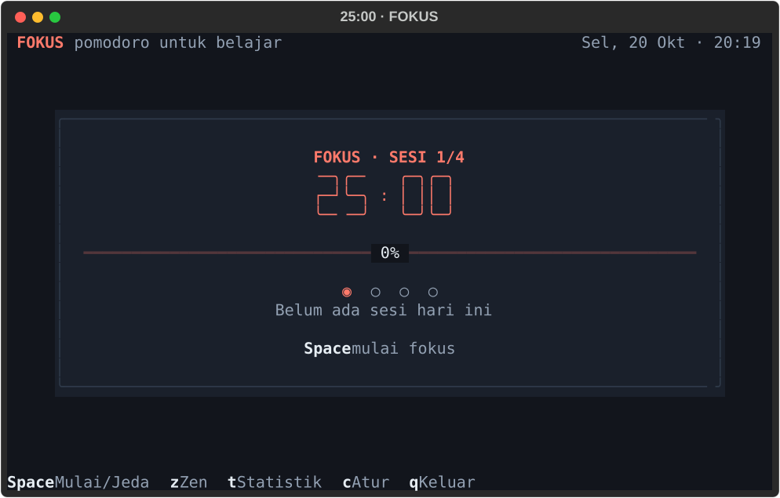
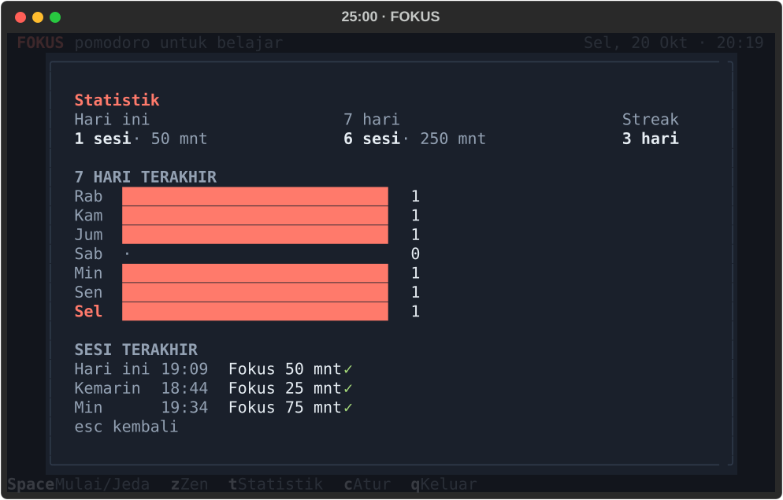
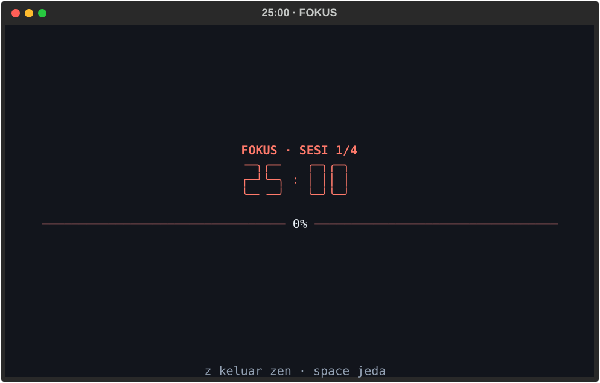

# FOKUS — Pomodoro TUI untuk Belajar

Timer Pomodoro berbasis terminal (TUI), 100% Python, dibangun dengan
[Textual](https://textual.textualize.io/). Antarmuka sederhana dan tenang:
satu kartu timer, digit besar, progres, dan statistik belajar harian.

**Paling cepat:** jalankan `.\run.cmd` dari folder project — satu baris,
tanpa perlu aktivasi venv.



## Install & jalankan (dari GitHub)

**Opsi 1 — paling gampang (Windows):** clone repo lalu jalankan:

```powershell
git clone https://github.com/ujangboy/belajar-python.git
cd belajar-python/03_Mini_Projects/pomodoro_tui
.\run.cmd
```

Bisa juga download ZIP lewat tombol **Code → Download ZIP**, ekstrak, lalu
jalankan `run.cmd` di folder `03_Mini_Projects/pomodoro_tui`.

**Opsi 2 — lewat pip (semua OS, tanpa download manual):**

```powershell
pip install "git+https://github.com/ujangboy/belajar-python.git#subdirectory=03_Mini_Projects/pomodoro_tui"
pomodoro
```

Setelah terpasang lewat pip, aplikasi bisa dibuka dari folder mana pun dengan
perintah `pomodoro` atau `fokus`.

## Fitur

- Timer Pomodoro berbasis deadline (tidak drift karena counting tick).
- Tiga fase: `FOKUS`, `ISTIRAHAT PENDEK`, `ISTIRAHAT PANJANG`.
- Alur default 25 / 5 / 15 menit, 4 sesi fokus per siklus.
- Istirahat mulai otomatis; fokus selalu dimulai manual.
- Kontrol: mulai/jeda, lewati fase, reset, mode zen, statistik,
  pengaturan, dan bantuan.
- Statistik: sesi & menit hari ini, grafik 7 hari terakhir, streak,
  dan 3 sesi terakhir.
- Pengaturan tersimpan di `config.json`, riwayat sesi di `sessions.jsonl`.
- Mode zen: hanya timer dan progres, tanpa distraksi.
- Terminal minimum 60 × 18; ada pesan ramah kalau terminal terlalu kecil.
- Tanpa jaringan, tanpa akun. Semua data lokal.

## Jalankan dengan satu baris

Di PowerShell atau cmd, dari folder project ini:

```powershell
.\run.cmd
```

Itu saja. `run.cmd` mencari Python yang cocok secara otomatis (venv repo,
venv project, atau Python di PATH), memasang dependency kalau belum ada,
lalu langsung membuka aplikasi. Tidak perlu aktivasi venv dan tidak perlu
`pip install` manual.

> Satu-satunya prasyarat di Windows: Python 3.11+ sudah terpasang. Kalau
> `run.cmd` bilang Python belum ditemukan, install dari
> <https://www.python.org/downloads/> dengan opsi **Add python.exe to PATH**
> dicentang, buka terminal baru, lalu jalankan lagi.

## Perintah global: `pomodoro` / `fokus`

Di mesin ini sudah dipasang dua perintah kecil di folder Scripts Python yang
sudah ada di PATH, jadi dari folder mana pun (tanpa `cd`) cukup:

```powershell
pomodoro
```

atau:

```powershell
fokus
```

Keduanya hanya pintu masuk yang memanggil `run.cmd` proyek ini, jadi
dependency, venv, dan data tetap sama. Bisa dipakai dari cmd maupun
PowerShell.

Catatan:

- Kalau folder project dipindah, perintah ini perlu diperbarui (atau minta
  saya edit ulang).
- Menghapus perintah: hapus file `pomodoro.cmd` dan `fokus.cmd` di
  `C:\Users\a7916\AppData\Local\Programs\Python\Python313\Scripts`.
- Di komputer lain, cara resminya: `pip install -e .` (memberi perintah
  `fokus` dan `pomodoro`), atau buat file `.cmd` serupa di folder yang ada
  di PATH.

## Prasyarat

- Python 3.11 atau lebih baru (dites di 3.13).
- Windows Terminal / PowerShell, atau terminal modern lain
  (Linux dan macOS juga jalan).
- Font monospace yang mendukung karakter kotak dan `● ◉ ○`
  (mis. Cascadia Mono, JetBrains Mono, Fira Code).

## Instalasi dependency

Kalau memakai `.\run.cmd`, langkah ini tidak perlu — dependency dipasang
otomatis pada run pertama. Untuk setup manual, dari folder project ini:

```powershell
# Aktifkan venv milik repo (kalau belum ada: python -m venv ..\..\.venv)
..\..\.venv\Scripts\Activate.ps1

# Install dependency runtime
pip install -r requirements.txt
```

Untuk kebutuhan development (test dan tool screenshot):

```powershell
pip install -r requirements-dev.txt
```

Opsional: pasang project ini sebagai package supaya ada perintah global
`fokus` / `pomodoro` yang bisa dipanggil dari folder mana pun:

```powershell
pip install -e .

# lalu dari folder mana pun:
fokus
```

## Cara lain menjalankan

Selain `.\run.cmd`, aplikasi juga bisa dijalankan dengan cara berikut
(semua dari folder project):

| Cara | Perintah |
| --- | --- |
| Venv bersama repo | `..\..\.venv\Scripts\python.exe main.py` |
| Venv sudah aktif | `python main.py` |
| Sebagai modul Python | `python -m fokus` |
| Setelah `pip install -e .` | `fokus` atau `pomodoro` (dari folder mana pun) |

Kalau muncul `ModuleNotFoundError: No module named 'textual'`, berarti yang
dipakai bukan Python yang punya Textual. Paling mudah pakai `.\run.cmd`.

## Kontrol

| Tombol | Aksi |
| --- | --- |
| `Space` | mulai / jeda |
| `s` | lewati fase (konfirmasi untuk sesi fokus) |
| `r` | reset timer fase ini |
| `z` | mode zen (keluar dengan `z` atau `Esc`) |
| `t` | statistik |
| `c` | pengaturan (saat idle / dijeda) |
| `?` | bantuan |
| `q` | keluar (konfirmasi kalau timer berjalan) |

## Alur Siklus

```text
FOKUS 25:00 ──selesai──▶ ISTIRAHAT PENDEK 5:00
     ▲                            │
     │                            ▼
     └────────────────────── FOKUS lagi

Setelah 4 sesi fokus selesai:
     └──▶ ISTIRAHAT PANJANG 15:00
```

- Istirahat mulai otomatis (bisa dimatikan di pengaturan).
- Fokus selalu dimulai manual, jadi tidak ada sesi belajar yang
  berjalan tanpa disadari.
- Sesi hanya dihitung selesai kalau timer fase fokus benar-benar habis.
- Melewati (`s`) sesi fokus tidak menghitung sesi itu sebagai selesai.

## Pengaturan

| Pengaturan | Rentang | Default |
| --- | --- | --- |
| Durasi fokus | 5–90 menit | 25 |
| Istirahat pendek | 1–30 menit | 5 |
| Istirahat panjang | 5–60 menit | 15 |
| Sesi per siklus | 2–8 | 4 |
| Auto-start istirahat | on/off | on |
| Suara (bell) | on/off | on |

Pengaturan bisa dibuka dengan `c` saat timer idle atau dijeda. Kalau timer
sedang berjalan, jeda dulu — timer yang sedang jalan tidak pernah diubah paksa.



## Lokasi Data

Secara default:

- Windows: `%APPDATA%\Fokus\`
- macOS: `~/Library/Application Support/Fokus/`
- Linux: `~/.local/share/fokus/` (atau `$XDG_DATA_HOME/fokus`)

Isi folder:

- `config.json` — pengaturan aplikasi.
- `sessions.jsonl` — riwayat sesi, satu JSON per baris.

Lokasi data bisa diganti lewat environment variable, misalnya untuk testing:

```powershell
$env:FOKUS_DATA_DIR = "D:\data\fokus"; .\run.cmd
```

## Struktur Project

```text
pomodoro_tui/
├─ run.cmd                   # satu perintah untuk menjalankan (Windows)
├─ main.py                   # entry point `python main.py`
├─ pyproject.toml            # metadata package + perintah `fokus`
├─ fokus/
│  ├─ app.py                # App Textual, keybinding, alur fase
│  ├─ timer.py              # state machine Pomodoro (bebas UI)
│  ├─ config.py             # Settings + lokasi data
│  ├─ storage.py            # baca/tulis config & riwayat
│  ├─ stats.py              # agregasi statistik
│  ├─ theme.py              # palet warna
│  ├─ fokus.tcss            # styling Textual
│  ├─ screens/              # statistik, pengaturan, bantuan, konfirmasi
│  └─ widgets/              # topbar, kartu timer, grafik mingguan
├─ tests/                   # unit + integration test (pytest)
├─ tools/                   # dev: screenshot & dump layout SVG
└─ docs/                    # screenshot SVG
```



## Testing

```powershell
..\..\.venv\Scripts\python.exe -m pytest -q
```

Kalau venv sudah aktif, cukup `python -m pytest -q`. 39 test mencakup:

- aturan transisi fase, termasuk siklus 4 sesi dan istirahat panjang;
- pause / resume / skip / reset;
- round-trip config dan riwayat sesi;
- agregasi statistik (hari ini, 7 hari, streak, sesi terakhir);
- alur UI lewat `run_test` ukuran 80×24 — modal konfirmasi, penyimpanan
  sesi selesai, pengaturan, statistik, dan mode zen;
- layout di 60×18 dan 120×30, plus resize terminal saat aplikasi berjalan.

## Alat Development

`tools/screenshot.py` — bikin ulang screenshot SVG ke `docs/`:

```powershell
python -m tools.screenshot
```

`tools/svg_dump.py` — ubah screenshot SVG jadi grid teks, berguna untuk
verifikasi layout tanpa membuka terminal:

```powershell
python -m tools.svg_dump docs/main.svg
```

## Desain

- Palet gelap tenang: latar `#12151C`, kartu `#1A202B`,
  teks `#E6EDF3`, muted `#93A1B3`.
- Warna fase hanya di aksen: fokus coral `#FF7A6B`,
  istirahat pendek mint `#5FD3C4`, istirahat panjang biru `#8AB4F8`.
- Satu border saja di kartu utama, tanpa emoji, tanpa kedip.
- Digit besar memakai widget `Digits`; progres memakai widget
  `ProgressLine` — satu baris membentang penuh dengan chip persentase
  di tengah.
- Statistik hanya menghitung sesi fokus yang selesai.

## Troubleshooting

- **`run.cmd` bilang "Python belum ditemukan"** — Python belum terpasang
  atau belum masuk PATH. Install Python 3.11+ dari
  <https://www.python.org/downloads/> dengan opsi
  *Add python.exe to PATH* dicentang, buka terminal baru, lalu jalankan
  `.\run.cmd` lagi.
- **`run.cmd` gagal memasang dependency** — biasanya tidak ada koneksi
  internet. Coba lagi, atau pasang manual dengan Python yang sama:
  `<path-python> -m pip install -r requirements.txt`. `run.cmd` sudah
  mencetak perintah lengkapnya kalau gagal.
- **`ModuleNotFoundError: No module named 'textual'`** — yang terpakai
  bukan Python yang punya Textual (biasanya `python` mengarah ke Python
  global, venv belum aktif). Paling mudah pakai `.\run.cmd`. Alternatif:
  `..\..\.venv\Scripts\python.exe main.py`, atau aktifkan venv
  (`..\..\.venv\Scripts\Activate.ps1`) lalu `pip install -r requirements.txt`.
  Cek interpreter yang aktif: `python -c "import sys; print(sys.executable)"`.
- **PowerShell menolak `Activate.ps1`** (execution policy) — tidak perlu
  aktivasi: pakai `.\run.cmd` atau jalur langsung
  `..\..\.venv\Scripts\python.exe main.py`. Kalau tetap ingin aktivasi,
  jalankan sekali: `Set-ExecutionPolicy -Scope CurrentUser RemoteSigned`.

## Catatan & Batasan

- **Suara bell** mengandalkan fitur bel terminal. Di Windows Terminal,
  aktifkan *Settings → Profiles → Defaults → Advanced → Bell* kalau ingin
  bunyi. Kalau tidak, notifikasi tetap muncul sebagai toast + judul tab.
- **Keluar saat timer berjalan**: sesi yang belum selesai tidak dihitung,
  dan timer selalu mulai dari kondisi idle saat aplikasi dibuka lagi.
- **Satu instance saja**: dua instance yang jalan bersamaan akan menulis
  ke file data yang sama.
- **Sleep laptop**: perilaku saat laptop tidur mengikuti jam monotonic OS —
  timer bisa ikut terhenti atau lanjut; sebaiknya jeda dulu sebelum
  meninggalkan laptop lama-lama.

## Non-Goals (v1)

Tanpa web/mobile, cloud sync, akun, task manager, musik, system tray,
atau notifikasi OS. Notifikasi cukup lewat toast Textual, bell terminal,
dan judul jendela terminal.

## Status

Versi 1.0.0 — siap dipakai. 39 test lulus dan aplikasi sudah dicoba berjalan
sungguhan di terminal (Windows Terminal / PowerShell) lewat `.\run.cmd`.
Perintah global `pomodoro` / `fokus` juga sudah diuji dari folder lain.

## Lisensi

Bebas dipakai untuk belajar.
